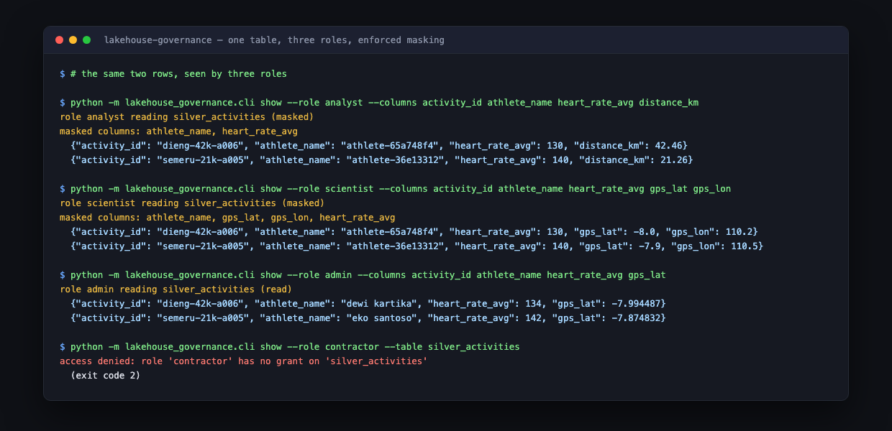

# Lakehouse Governance

A medallion lakehouse where the governance is enforced rather than described: roles decide what a
query can read, sensitive columns are degraded at query time, and every published column traces back
to the raw file it came from — with tests that fail if any of that stops being true.

Governance is the easiest thing in data engineering to claim and the hardest to demonstrate. A policy
document says "analysts cannot see precise location"; only an assertion proves it.



## What it does

1. **Bronze** ingests new activity files and remembers which ones it has already read, so a scheduled
   run is safe to repeat and a redelivery is never lost.
2. **Silver** resolves redeliveries with `MERGE`: the latest delivery wins, the earlier version stays
   in Bronze, and provenance columns are never overwritten.
3. **Gold** publishes weekly per-event aggregates — the only table most people should query.
4. **Policies** (`policy.yaml`) decide table grants, column denials, and how sensitive columns are
   masked per role, with the masking applied in the projection and never at rest.
5. **Lineage** is declared per column, rendered as a graph, and verified against the live schema so
   it cannot drift.

## Quickstart

```bash
python3 -m venv .venv
.venv/bin/pip install -e '.[dev]'

python -m lakehouse_governance.cli generate --source data/source
python -m lakehouse_governance.cli run --source data/source --db data/lakehouse.duckdb \
    --checkpoint data/checkpoints/ingest.json
python -m lakehouse_governance.cli show --db data/lakehouse.duckdb --role analyst --table silver_activities --limit 2
python -m lakehouse_governance.cli roles
python -m lakehouse_governance.cli lineage --db data/lakehouse.duckdb
```

```text
bronze   files read 3, skipped 0, rows added 49, total 49
silver   rows 48, inserted 48, corrections applied 1, duplicate deliveries resolved 1
gold     rows 8
lineage  verified
```

## The policy model

| Role | `bronze_activities` | `silver_activities` | `gold_weekly_summary` | Notes |
| --- | --- | --- | --- | --- |
| `admin` | read | read | read | platform owner, full precision |
| `scientist` | — | masked | read | coordinates rounded to ~11 km |
| `analyst` | — | masked | read | coordinates denied entirely |
| `contractor` | — | — | read | aggregates only |

What "masked" means, per column:

| Column | Mask | Why |
| --- | --- | --- |
| `gps_lat`, `gps_lon` | `ROUND(x, 1)` | Regionally useful, useless as a home address |
| `heart_rate_avg`, `heart_rate_max` | `FLOOR(x/10)*10` | Keeps the health signal for aggregates, drops the exact reading |
| `athlete_name` | `'athlete-' \|\| SUBSTR(MD5(name), 1, 8)` | Joins still work; identity is gone |

The same two activities seen through three roles — analyst `130 bpm`, scientist `130 bpm` with
rounded coordinates, admin the true `134 bpm` and `-7.994487` — is in
[`docs/evidence/run.md`](docs/evidence/run.md).

## Lineage

`lineage.yaml` declares each column's upstream column. The lineage command renders a Mermaid graph and
compares the metadata against the live schema in **both** directions:

```text
gold_weekly_summary.avg_heart_rate → silver_activities.heart_rate_avg → bronze_activities.heart_rate_avg
```

A column added in SQL without being declared fails the check, as does a declared column that no
longer exists. Automatically correct diagrams are a Unity Catalog feature; declared-and-verified
metadata is the local equivalent, and the drift test is what keeps it honest.

## Reading this as a Databricks exercise

The mechanisms map onto Unity Catalog features, and
[`docs/unity-catalog-mapping.md`](docs/unity-catalog-mapping.md) lists each one with what is the same
and what genuinely differs — table grants, column masks, row filters, automatic lineage, audit logs,
external locations, and identity.

**The most important line in that document:** `--role` is a parameter, not authentication. This
project demonstrates that a policy layer decides consistently and that the decisions are testable; it
does *not* demonstrate that access is impossible. That distinction is the difference between a
governance demo and a secure platform, and it is worth being the first thing to say about it.

## Tests

```bash
.venv/bin/python -m pytest -q    # 42 passed
.venv/bin/ruff check .
```

They cover the access matrix (including refusals), masking behaviour and the fact that stored values
are untouched, checkpointed ingestion (including a corrupt checkpoint and an increasing sequence),
MERGE semantics for redeliveries, Gold reconciliation against Silver, lineage tracing and cycle
detection, schema-drift detection in both directions, and the CLI's exit codes.

## Deliberate limitations

- **Not a security boundary.** Roles are passed on the command line; a real deployment binds them to
  authenticated identities. Bypassing `catalog.py` bypasses the policy.
- **No row-level filters.** Unity Catalog can restrict rows by attribute; this supports table and
  column decisions only.
- **No audit log.** `masked_columns()` exists to feed one, but nothing is recorded.
- **No time travel.** Delta's transaction log would let a query read Silver as of yesterday; DuckDB
  has no equivalent here.
- **Lineage is declared, not derived.** It catches drift because a test compares it to the schema, but
  it knows nothing about an ad-hoc query someone ran elsewhere.
- **Single-node, local files.** No external locations, credential vending, or storage permissions.

## Next

1. **Bind roles to real identities** — read the principal from an OIDC token instead of a flag, so the
   policy layer becomes a boundary rather than a demonstration.
2. **Add row-level filters** (region, squad) to complete the Unity Catalog feature set.
3. **Emit an audit record** per read: principal, table, columns requested, columns masked, rows
   returned.
4. **Derive lineage from executed SQL** so ad-hoc queries are covered, using the declared metadata as
   the baseline it must agree with.
