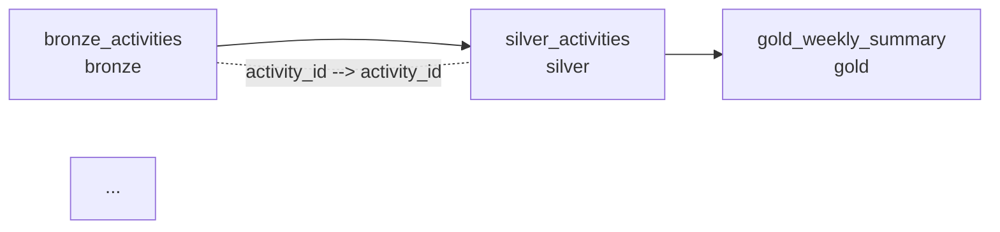

# Evidence: pipeline, masking, and lineage

Captured on 2026-10-25. Reproduce with:

```bash
python -m lakehouse_governance.cli generate --source data/source
python -m lakehouse_governance.cli run --source data/source --db data/lakehouse.duckdb --checkpoint data/checkpoints/ingest.json
python -m lakehouse_governance.cli show --db data/lakehouse.duckdb --role analyst --table silver_activities --limit 2
python -m lakehouse_governance.cli lineage --db data/lakehouse.duckdb
```

## Pipeline

```text
$ python -m lakehouse_governance.cli run --source data/source --db data/lakehouse.duckdb
bronze   files read 3, skipped 0, rows added 49, total 49
silver   rows 48, inserted 48, corrections applied 1, duplicate deliveries resolved 1
gold     rows 8
lineage  verified
```

- **49 Bronze rows from 48 activities.** The extra row is the deliberate redelivery: Bronze keeps
  both versions, and `duplicate deliveries resolved 1` shows Silver chose between them.
- **Silver holds 48 rows for 48 activities** — one row each, with the corrected values.
- **Gold holds 8 rows**: four events across two weeks, which is what an analyst or a contractor
  actually needs.
- **`lineage verified`** means the declared metadata matches the live schema in both directions.

A second run of the same command reports `files read 0, rows added 0` and leaves Silver and Gold
unchanged, which a test asserts.

## One table, three roles

The same two activities, read by three roles through the policy layer:

```text
$ python -m lakehouse_governance.cli show --role analyst --columns activity_id athlete_name heart_rate_avg distance_km
role analyst reading silver_activities (masked)
masked columns: athlete_name, heart_rate_avg
  {"activity_id": "dieng-42k-a006", "athlete_name": "athlete-65a748f4", "heart_rate_avg": 130, "distance_km": 42.46}
  {"activity_id": "semeru-21k-a005", "athlete_name": "athlete-36e13312", "heart_rate_avg": 140, "distance_km": 21.26}

$ python -m lakehouse_governance.cli show --role scientist --columns activity_id athlete_name heart_rate_avg gps_lat gps_lon
role scientist reading silver_activities (masked)
masked columns: athlete_name, gps_lat, gps_lon, heart_rate_avg
  {"activity_id": "dieng-42k-a006", "athlete_name": "athlete-65a748f4", "heart_rate_avg": 130, "gps_lat": -8.0, "gps_lon": 110.2}
  {"activity_id": "semeru-21k-a005", "athlete_name": "athlete-36e13312", "heart_rate_avg": 140, "gps_lat": -7.9, "gps_lon": 110.5}

$ python -m lakehouse_governance.cli show --role admin --columns activity_id athlete_name heart_rate_avg gps_lat
role admin reading silver_activities (read)
  {"activity_id": "dieng-42k-a006", "athlete_name": "dewi kartika", "heart_rate_avg": 134, "gps_lat": -7.994487}
  {"activity_id": "semeru-21k-a005", "athlete_name": "eko santoso", "heart_rate_avg": 142, "gps_lat": -7.874832}

$ python -m lakehouse_governance.cli show --role contractor --table silver_activities
access denied: role 'contractor' has no grant on 'silver_activities'
  (exit code 2)
```

What to observe:

- **The same activity shows 130 bpm to an analyst and 134 to an admin** — the mask is `FLOOR(hr/10)*10`,
  so the health signal survives for aggregate analysis while the exact reading does not.
- **Names are pseudonymised, not removed**, which keeps joins working without exposing identity.
- **Only the scientist sees coordinates**, rounded to one decimal (roughly 11 km) — enough for
  regional analysis, useless as a home address. The analyst is denied the columns outright, and
  asking for them by name raises rather than silently returning fewer columns.
- **The contractor cannot reach the row-level table at all**, only the aggregates.

## Lineage

```text
$ python -m lakehouse_governance.cli lineage --db data/lakehouse.duckdb
tables      3
edges       24
pii columns 5
metadata drift: none
```



Every column in `gold_weekly_summary` traces to a specific Bronze column — the full path is asserted
in the tests, for example:

```text
gold_weekly_summary.avg_heart_rate → silver_activities.heart_rate_avg → bronze_activities.heart_rate_avg
```

The drift check is bidirectional: a column added to a table without being declared, or declared but
missing from the database, both fail. A CLI test asserts the failure path too, because a verification
that cannot fail is decoration.

## Tests

```text
$ .venv/bin/python -m pytest -q
42 passed in 0.87s
$ .venv/bin/ruff check .
All checks passed!
```

The suite includes four assertions that only exist to keep governance honest: an analyst cannot
select coordinates, a masked heart rate is a multiple of ten while the stored value is untouched, the
corrected delivery survives a redelivery while Bronze keeps both versions, and lineage metadata must
match the live schema.
